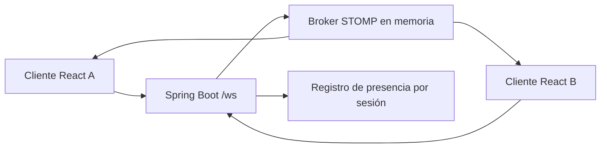

# Arquitectura y cambios de preparación

## Correcciones

- Java 21 y eliminación de source/target 7 contradictorios.
- URL y orígenes configurables, sin IP privada fija.
- Conexión del transporte separada de la aceptación del alias por el servidor.
- Una instancia de conexión por efecto React y cancelación de conexiones pendientes.
- Nombre de remitente derivado de la sesión registrada.
- Registro de presencia sincronizado y eliminación al recibir SessionDisconnectEvent.
- Confirmación privada de registro mediante /user/queue/registration.
- Límite de 2000 caracteres para mensajes en cliente y servidor.

La aplicación conserva el diseño existente. Estos ajustes no convierten el prototipo
en una plataforma de mensajería autenticada o distribuida.
